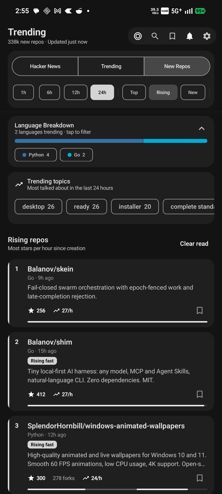
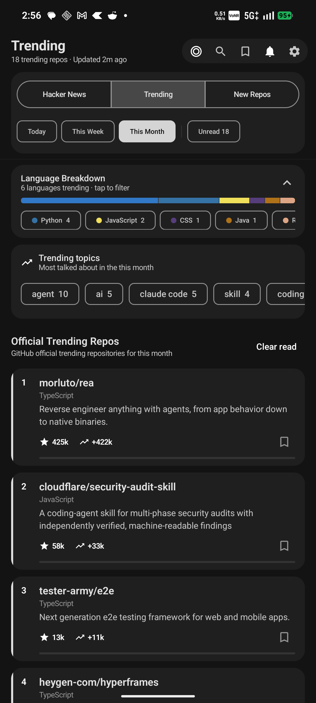
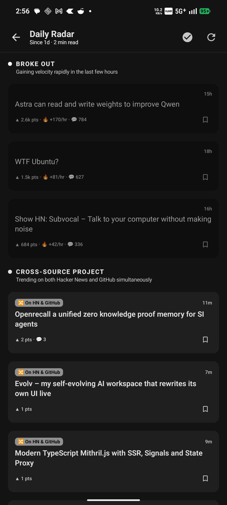
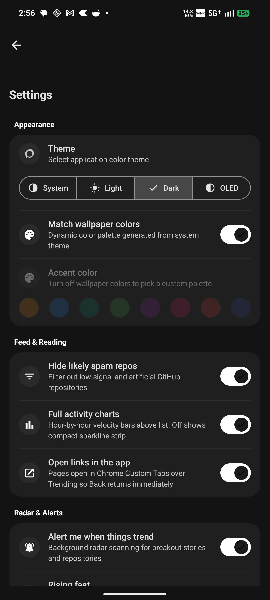

<p align="center">
  
</p>

<h1 align="center">Trending</h1>

<p align="center">
  A native Android app for developers that monitors breakout stories and repositories across Hacker News and GitHub.
</p>

<p align="center">
  <a href="https://android.com"></a>
  <a href="https://www.rust-lang.org"></a>
  <a href="https://developer.android.com/jetpack/compose"></a>
  <a href="https://m3.material.io"></a>
  <a href="https://github.com/karmugilen/trending/releases/latest"></a>
</p>

---

## Overview

Trending is built for software engineers who want signal over noise. Instead of encouraging infinite scrolling, the app answers a simple daily question: *did anything important break out today that affects my stack or interests?*

The project combines two strengths:
- **Rust Engine (`core/`)**: Cross-compiled JNI library that handles tokenization, velocity calculations, windowed data aggregation, and local caching.
- **Jetpack Compose UI (`app/`)**: Responsive Material 3 client featuring continuous activity wave sparklines, segmented controls, and native dynamic theming.
- **Privacy by Default**: No user accounts, no telemetry tracking, and no external middleman servers. Everything runs on your device.

---

## Screenshots

<table align="center">
  <tr>
    <td align="center" width="25%">
      <br />
      <b>Hacker News & Velocity Wave</b>
    </td>
    <td align="center" width="25%">
      <br />
      <b>GitHub Trending Repos</b>
    </td>
    <td align="center" width="25%">
      <br />
      <b>Daily Radar Briefing</b>
    </td>
    <td align="center" width="25%">
      <br />
      <b>Settings & Preferences</b>
    </td>
  </tr>
</table>

---

## Features

- **Dual-Source Aggregation**:
  - **Hacker News**: Live points, comments, velocity ranking, and linked discussion threads.
  - **GitHub**: Official trending lists (Today, This Week, This Month) and newly created breakout repositories.
- **Continuous Velocity Charts**: Custom smooth area charts illustrating hour-by-hour velocity and peak traction.
- **Streamlined Navigation**: Minimalist segmented buttons for quick switching between sources, custom time ranges (1h, 6h, 12h, 24h), and ranking modes (Top, Rising, New).
- **Proactive Radar**: Local background worker that scans for breakout events, security disclosures, and dependencies matching your projects.
- **Local Spam Filtering**: Strips star-inflation farming and spam repositories directly in the native engine.
- **Desktop Companion**: Optional local Python FastAPI backend (`web/`) for viewing feeds in your desktop browser.

---

## Download APK

Pre-built signed release APKs are available on the [Releases](https://github.com/karmugilen/trending/releases) page:

| Package | Target Architecture | Description |
| :--- | :--- | :--- |
| **[Trending-v1.5.0-universal.apk](https://github.com/karmugilen/trending/releases/latest)** | Universal | Works on all Android devices (contains all native ABIs) |
| **[Trending-v1.5.0-arm64-v8a.apk](https://github.com/karmugilen/trending/releases/latest)** | `arm64-v8a` | Optimized for modern 64-bit Android smartphones |
| **[Trending-v1.5.0-armeabi-v7a.apk](https://github.com/karmugilen/trending/releases/latest)** | `armeabi-v7a` | For 32-bit ARM Android devices |
| **[Trending-v1.5.0-x86_64.apk](https://github.com/karmugilen/trending/releases/latest)** | `x86_64` | For 64-bit Android emulators and Intel/AMD Chromebooks |
| **[Trending-v1.5.0-x86.apk](https://github.com/karmugilen/trending/releases/latest)** | `x86` | For 32-bit x86 Android emulators |

Requires Android 8.0 (API 26) or higher.

---

## Architecture

```
trending/
├── app/                  # Android Native Client (Kotlin + Jetpack Compose)
│   └── src/main/java/app/omalauncher/trending/
│       ├── ui/           # Screens, Components, Theme, Charts
│       ├── data/         # SettingsStore, Preferences, Disk Cache
│       ├── worker/       # WorkManager Background Radar
│       └── logic/        # Native JNI Glue & Models
├── core/                 # Core Engine (Rust cdylib)
│   ├── src/
│   │   ├── lib.rs        # JNI Bridge entrypoints
│   │   ├── feed.rs       # Parsing, scoring & window aggregation
│   │   ├── signals.rs    # Velocity calculation & spam heuristic
│   │   ├── topics.rs     # Dynamic topic extraction with lift
│   │   └── alerts.rs     # Deduplication & alerting discipline
│   └── Cargo.toml
├── web/                  # Desktop Web Client (FastAPI / HTML5)
├── fast-build.sh         # Targeted incremental build script
└── assets/               # App icons and interface screenshots
```

---

## Building from Source

### Prerequisites

- **JDK 17+**
- **Android SDK & NDK** (API 26+)
- **Rust Toolchain** with Android cross-compilation targets:
  ```bash
  rustup target add aarch64-linux-android armv7-linux-androideabi x86_64-linux-android i686-linux-android
  ```

### Local Setup

Create a `local.properties` file in the repository root pointing to your Android SDK:
```properties
sdk.dir=/path/to/your/Android/Sdk
```

### Fast Development Build

For rapid iterative testing on a connected device:
```bash
# Fast debug build (skips minification for quick iteration)
./fast-build.sh debug

# Fast release build
./fast-build.sh release
```

### Full Gradle Build

```bash
# Run Rust unit tests
cargo test --manifest-path core/Cargo.toml

# Build release APKs for all architectures
./gradlew :app:assembleRelease
```

Compiled APKs will be located in `app/build/outputs/apk/release/`.

---

## Desktop Viewer

To run the local desktop viewer:
```bash
./run_web.sh
```
Then navigate to `http://127.0.0.1:8080` in your browser.

---

## License

This project is licensed under the [MIT License](LICENSE).
